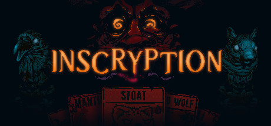

**Inscryption by Daniel Mullins Games (2021) is a deckbuilding roguelite wrapped in a meta-horror narrative.**

---

## 📖 About

Inscryption by Daniel Mullins Games (2021) is a deckbuilding roguelite wrapped in a meta-horror narrative. The game shifts between three distinct gameplay modes as secrets are uncovered. Early acts demand specific sacrifice synergies that punish disorganized decks severely.

## ⚠️ Problems Without Trainer

| Problem | Status |
|---------|--------|
| Sacrifice chains break when key cards are removed by enemy effects | ✅ Solved |
| Bone economy dries up when opponent uses low-cost high-value cards | ✅ Solved |
| Rare sigils never appear in card rewards for critical build moments | ✅ Solved |
| Cabin puzzle solutions reset progress after certain narrative triggers | ✅ Solved |
| Candle death mechanic resets entire deck state after multiple losses | ✅ Solved |

## ✅ Solution

The **Inscryption Trainer** solves all these issues, giving you complete control so you can focus on enjoying the game.

## 🎯 Features

- Unlimited Resources / Currency
- God Mode / Invincibility
- Instant Skill & Ability Cooldown
- One-Hit Kill
- Freeze Timers
- Unlock All Items & Achievements
- Custom Speed Multiplier
- Infinite Stamina / Energy

## 🚀 Quick Start

1. **Disable Windows Defender** temporarily (trainer may trigger false positive)
2. Get the trainer from the button above
3. Launch Inscryption
4. Run the trainer as Administrator
5. Use the hotkeys to activate cheats in-game

## 💎 Free vs Pro

| Feature | Free | Pro |
|---------|------|-----|
| God Mode | ✅ | ✅ |
| Unlimited Resources | ✅ | ✅ |
| Advanced Cheats | ❌ | ✅ |
| Auto-Updates | ❌ | ✅ |
| Priority Support | ❌ | ✅ |

## 💻 Requirements

- Windows 10 / 11 (64-bit)
- Inscryption (any version)
- .NET Framework 4.8+
- DirectX 11+

## 🍎 macOS

## ⚖️ Legal

Educational and single-player use only.

---

